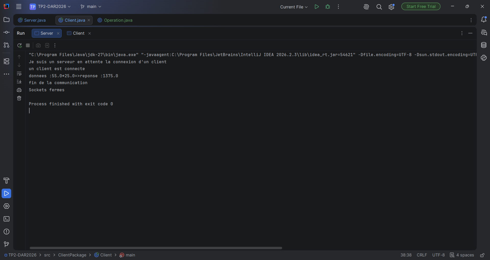
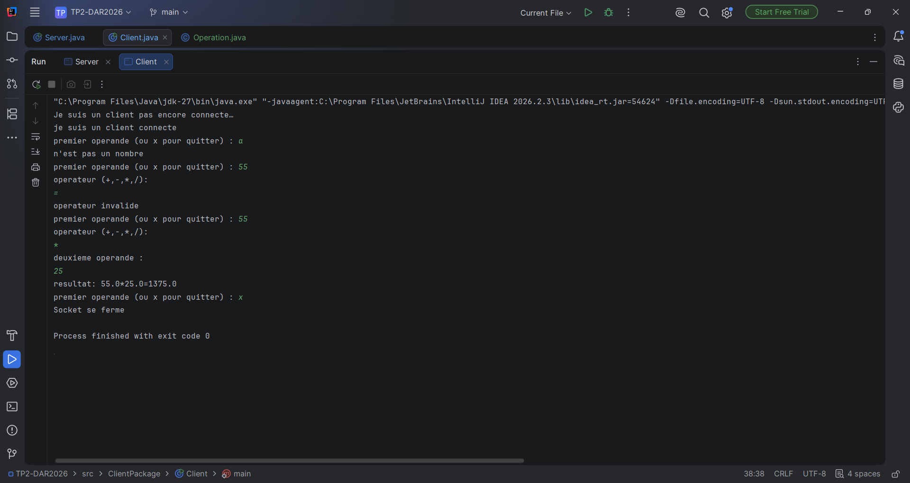

# TP2 – Activité 2-1 : Échange de CC entre Client/Serveur via les Sockets TCP

## Sortie du serveur

## Sortie du client

# TP2 – Activité 2-2 : Échange des objets entre Client/Serveur via les Sockets TCP

## Sortie du serveur

## Sortie du client
